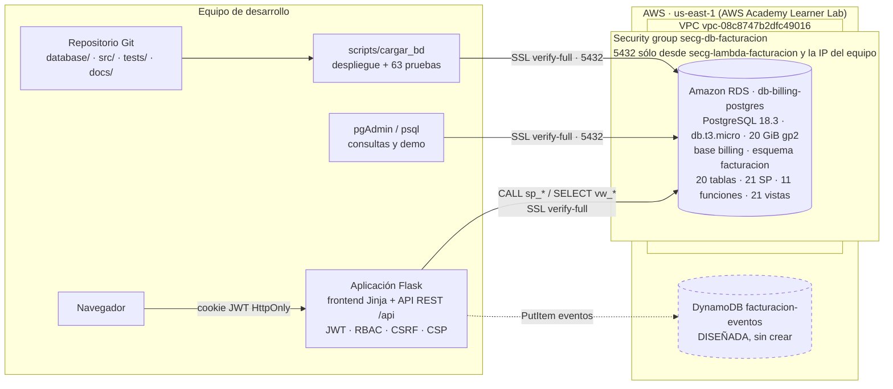
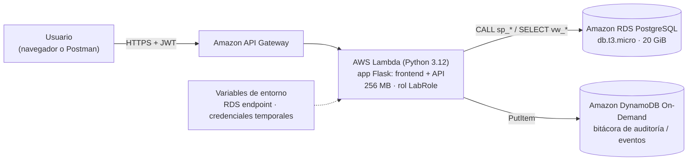
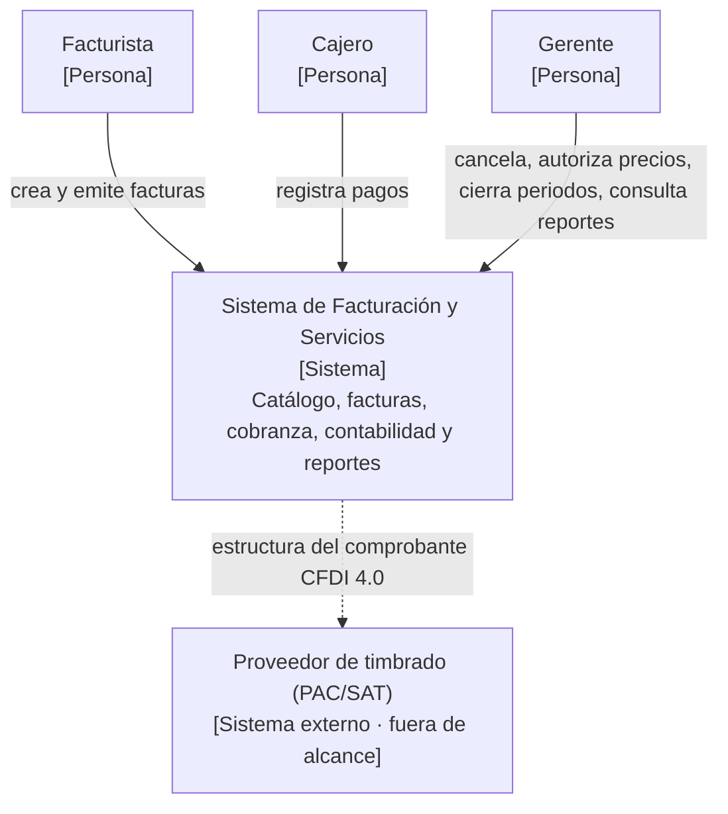
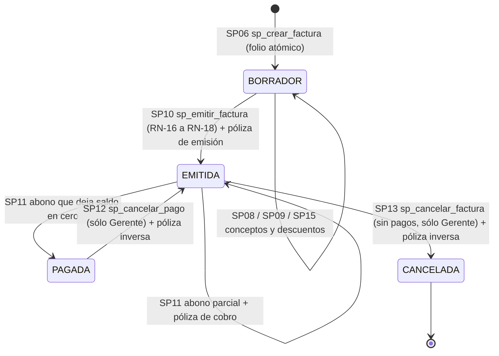
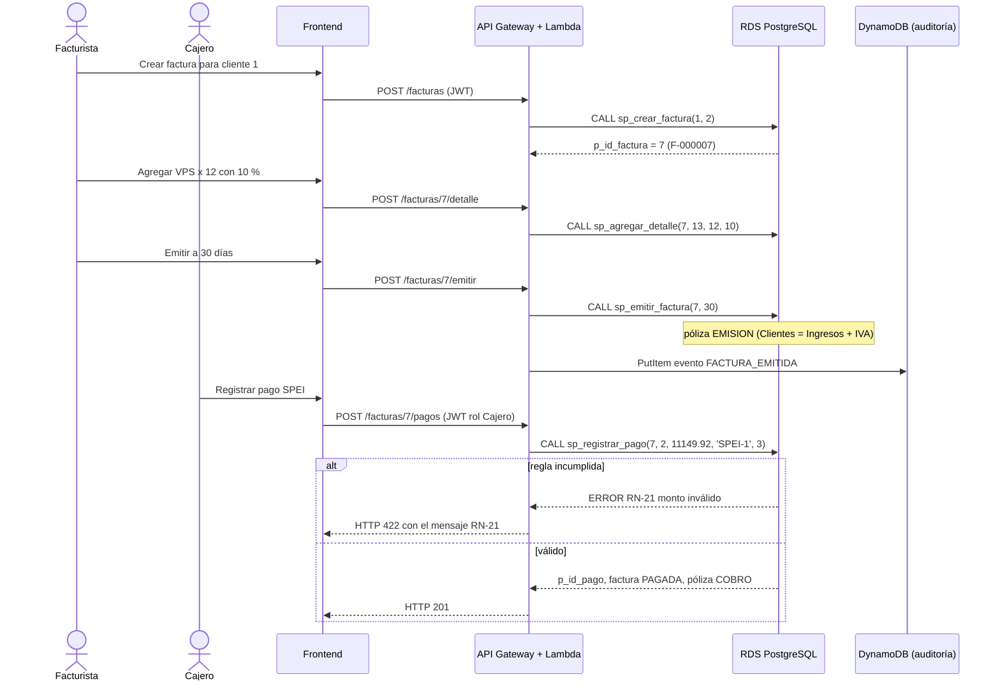
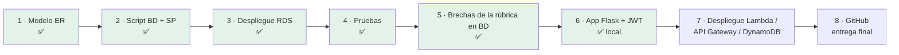

# Sistema de Facturación y Servicios: Reporte de Avance (Revisión 1)

> **Versión preliminar, 19 de noviembre de 2026 (actualizada al cierre del día). No es la versión final.**
> Optativa I · Bases de Datos en la Nube · Proyecto C · Entorno: AWS Academy Learner Lab
> **Equipo 3:** Dana Bahena Díaz, Isaac Leonardo López Flores, Renata Lizbeth Ortiz Chávez, Daniel Rosales Alanis

Los diagramas usan **Mermaid**, que GitHub dibuja automáticamente al abrir el archivo.

## Contenido
1. [Resumen del avance](#1-resumen-del-avance)
2. [Evaluación contra la rúbrica oficial](#2-evaluación-contra-la-rúbrica-oficial)
3. [Arquitectura y servicios utilizados](#3-arquitectura-y-servicios-utilizados)
4. [Modelo de datos](#4-modelo-de-datos)
5. [Lógica de negocio](#5-lógica-de-negocio)
6. [Pruebas y evidencias](#6-pruebas-y-evidencias)
7. [Progreso de desarrollo](#7-progreso-de-desarrollo)
8. [Pendientes para la versión final](#8-pendientes-para-la-versión-final)
9. [Parte visual: prototipo y guion de pruebas](#9-parte-visual-prototipo-y-guion-de-pruebas)
10. [Cómo generar reportes](#10-cómo-generar-reportes)
11. [Cómo generar y exportar los diagramas](#11-cómo-generar-y-exportar-los-diagramas)
12. [Documentos relacionados](#12-documentos-relacionados)

---

## 1. Resumen del avance

La base de datos relacional está desplegada en Amazon RDS y probada (**63 de 63 pruebas**). Cumple el volumen que pide la rúbrica (100 servicios y 50 características), tiene las 8 tablas que nombra el Proyecto C (20 en total) y **cubre los 10 propósitos de procedimientos** con 21 SP.

La **aplicación en Flask (Python)** está conectada a RDS y probada (**25 de 25 pruebas**). Incluye:
- Frontend con plantillas Jinja.
- API REST de 29 endpoints con JWT, documentada en OpenAPI.
- Control de acceso por rol en cada endpoint y protección contra inyección SQL, XSS y CSRF.

Falta desplegarla en AWS (API Gateway y Lambda) y crear la tabla de DynamoDB, cuyo esquema ya está definido. Si se entregara hoy, la estimación interna es de **72 a 87 puntos de 100** (sección 2.3).

| Área | Estado | Evidencia principal |
| --- | --- | --- |
| Modelo de datos | Completado | 20 tablas: las 10 del diagrama ER del equipo + 10 de extensión (sección 4) |
| Base de datos y reglas de negocio | Completado | `database/`: 21 SP, 11 funciones, 21 vistas, 1 trigger, reglas RN-01 a RN-33 |
| Despliegue en la nube | Completado | Instancia `db-billing-postgres` en Amazon RDS, PostgreSQL 18.3 |
| Despliegue automatizado de la base | Completado | `scripts/cargar_bd.ps1` y `scripts/cargar_bd.sh` leen la conexión de `.env` |
| Pruebas | Completado | Base: `database/resultado_pruebas.txt` (63 OK). Aplicación: `tests/` (25 OK) |
| Aplicación Flask (frontend + API) | Completado en local | `src/app/`; probada contra RDS |
| Seguridad | Completado en la aplicación | JWT, bcrypt, RBAC, CSRF, CSP y consultas parametrizadas |
| Documentación de la API | Completado | `docs/openapi.yaml` (validado; coincide con las 29 rutas) |
| DynamoDB | Diseñado | `database/dynamodb/eventos_auditoria.json`; la app ya escribe los eventos cuando existe la tabla |
| API Gateway + Lambda | Preparado | `src/lambda_handler.py`; falta crear los recursos en AWS |
| Control de versiones | En progreso | Repositorio Git local con historial por etapa; falta subirlo a GitHub |

---

## 2. Evaluación contra la rúbrica oficial

Fuente: *Lineamientos Técnicos y Rúbrica de Evaluación de Proyectos Finales* (`docs/rubrica_proyecto_final.pdf`), Proyecto C: Sistema de Facturación y Servicios.

### 2.1 Requisitos específicos del Proyecto C

| Requisito de la rúbrica | Estado | Evidencia o brecha |
| --- | --- | --- |
| 100 servicios | ✅ Cumplido | 100 servicios en 10 categorías, cargados con SP02 |
| 50 características configurables | ✅ Cumplido | 50 características tipificadas y 1,220 valores en `servicio_caracteristicas` |
| Mínimo 8 tablas en RDS | ✅ Cumplido (20) | Las 10 del diagrama + 10 de extensión |
| Clientes, Facturas, Detalle_Factura, Servicios, Características_Servicio, Pagos | ✅ Cumplido | `clientes`, `facturas`, `detalle_factura`, `servicios`, `caracteristicas` + `servicio_caracteristicas`, `pagos` |
| Impuestos_Histórico | ✅ Cumplido | `impuestos_historico` (IVA 15 % → 16 %, retenciones de ISR e IVA, con vigencia) y `factura_impuestos` |
| Usuarios_Roles | ✅ Cumplido | `usuarios` (hash bcrypt, bloqueo por intentos) y `roles`; los permisos de los SP salen del rol |
| DynamoDB (auditoría, sesiones, carritos o eventos) | ⚠️ Diseñado | Tabla de eventos inmutables On-Demand con 2 GSI (`database/dynamodb/`); la app ya la usa; falta crearla en AWS |
| Mínimo 10 SP en RDS | ✅ Cumplido (21) | Los 10 propósitos cubiertos (ver 2.2) |

### 2.2 Los 10 procedimientos que pide la rúbrica

| # | Propósito requerido | Implementación | Estado |
| --- | --- | --- | --- |
| 1 | Generación e iteración atómica de folios | SP06 `sp_crear_factura` con `pg_advisory_xact_lock` | ✅ Cumplido |
| 2 | Cálculo de subtotal, IVA y retenciones | SP07 `sp_recalcular_totales`: tasas vigentes de `impuestos_historico`; retenciones de ISR 10 % e IVA 2/3 según `condiciones_cliente` | ✅ Cumplido |
| 3 | Descuentos por cliente o volumen | `fn_descuento_automatico` en SP08; SP15 `sp_aplicar_descuentos` | ✅ Cumplido |
| 4 | Cancelación formal y reversión contable | SP13 y SP12 llaman a SP16 `sp_contabilizar`, que genera la póliza inversa | ✅ Cumplido |
| 5 | Cierre y consolidado fiscal diario o mensual | SP17 `sp_cierre_fiscal` → `cierres_fiscales` | ✅ Cumplido |
| 6 | Validación de estados de pago | SP11 y SP12 (RN-19 a RN-23) | ✅ Cumplido |
| 7 | Reporte de antigüedad de saldos | `fn_antiguedad_saldos(fecha_corte)` y `vw_antiguedad_saldos` (por vencer, 1–30, 31–60, 61–90, más de 90) | ✅ Cumplido |
| 8 | Estructura para comprobante o timbrado | SP18 `sp_generar_comprobante` → JSON CFDI 4.0 en `comprobantes` | ✅ Cumplido (el timbrado con un PAC queda fuera de alcance) |
| 9 | Asignación masiva de características | SP19 `sp_asignar_caracteristicas_masivo` (arreglo JSON, todo o nada) | ✅ Cumplido |
| 10 | Auditoría de cambios en tarifas | Trigger `tg_auditar_tarifa` → `auditoria_tarifas`; registra también un `UPDATE` directo | ✅ Cumplido |

**Resultado:** 10 de 10 cumplidos. La antigüedad de saldos es una función y no un procedimiento porque devuelve un conjunto de filas; en PostgreSQL un `PROCEDURE` no puede devolver una tabla.

### 2.3 Autoevaluación por rubro (estimación interna, no oficial)

| Rubro | Peso | Nivel actual | Puntos estimados | Qué lo sube a Excelente |
| --- | --- | --- | --- | --- |
| 1. Diseño, modelado y rigor en BD | 30 | Excelente | 26–29 | Crear la tabla de DynamoDB; ER actualizado en draw.io |
| 2. Arquitectura en AWS y Learner Lab | 25 | Suficiente | 14–18 | Desplegar en API Gateway + Lambda con LabRole, crear DynamoDB, apagar RDS fuera de horario |
| 3. Lógica de negocio y SP | 20 | Excelente | 17–19 | Los 21 SP ya se llaman desde la aplicación; folios y cobros con bloqueos |
| 4. Ciberseguridad, RBAC y OWASP | 15 | Excelente | 12–14 | Probar los mismos ataques contra la versión desplegada (https) |
| 5. Frontend, documentación y Git | 10 | Suficiente | 3–7 | GitHub con commits de los 4 integrantes |
| **Total** | **100** | | **72–87** | |

### 2.4 Checklist de entregables del repositorio

| Entregable | Estado |
| --- | --- |
| `/database`: DDL y DML | ✅ `database/01_esquema.sql` y `database/03_datos.sql` |
| `/database`: script independiente de Stored Procedures | ✅ `database/02_procedimientos.sql` |
| `/database`: esquema JSON de DynamoDB e índices | ✅ `database/dynamodb/eventos_auditoria.json` (On-Demand, 2 GSI) |
| `/docs`: diagrama ER actualizado | ✅ Sección 4 de este archivo (20 tablas) |
| `/docs`: diagrama de arquitectura AWS | ✅ Actual y objetivo en la sección 3 |
| `/docs`: colección de Postman u OpenAPI | ✅ `docs/openapi.yaml` (se importa en Postman) |
| Código Python (Flask) y frontend | ✅ `src/app/`: frontend Jinja + API REST; `tests/` con 25 pruebas |
| `README.md` con instrucciones de ejecución y conexión a AWS | ✅ Configuración, base, app, pruebas, seguridad y despliegue |
| Repositorio en GitHub | ❌ Falta (sólo repositorio local) |

---

## 3. Arquitectura y servicios utilizados

### 3.1 Arquitectura actual (Revisión 1)



### 3.2 Arquitectura objetivo (versión final, la que pide la rúbrica)



### 3.3 Vista C4: contexto del sistema (nivel 1)



### 3.4 Servicios y herramientas

| Servicio o herramienta | Uso en el proyecto | Por qué se eligió |
| --- | --- | --- |
| Amazon RDS for PostgreSQL 18.3 | Base de datos (`db-billing-postgres`, db.t3.micro, 20 GiB gp2, us-east-1) | Base administrada con respaldos, cifrado y parches; cumple el límite del Learner Lab |
| Amazon VPC y Security Groups | Red y firewall de la instancia | El puerto 5432 sólo acepta la IP del equipo |
| AWS Academy Learner Lab | Cuenta y consola de AWS | Entorno oficial de la materia (crédito de 100 USD) |
| PostgreSQL (PL/pgSQL) | Tablas, 21 SP, 11 funciones, 21 vistas, 1 trigger | Procedimientos con transacciones y control de errores por regla |
| PostgreSQL 18.7 local | Plan B para la demo (servidor local instalado con winget) | Mismo comportamiento sin depender de la red; antes se validó también en 16.15 |
| pgAdmin 4 y psql | Carga de scripts, consultas y demo | Clientes oficiales de PostgreSQL |
| PowerShell y Bash | Scripts de despliegue `scripts/cargar_bd.*` | Carga reproducible: leen `.env`, protegen contra borrados y cuentan pruebas |
| Flask 3.1 (Python) | Aplicación completa: frontend con Jinja y API REST | Lenguaje y framework que pide la rúbrica; Jinja escapa la salida contra XSS |
| psycopg 3 + psycopg-pool | Conexión a RDS con SSL `verify-full` y pool de conexiones | Parámetros enlazados en el servidor: sin inyección SQL |
| PyJWT, bcrypt, pydantic | Tokens JWT, hash de contraseñas y validación de entradas | Autenticación con tokens, contraseñas sin texto plano, entradas acotadas |
| pytest | 25 pruebas de la API y del frontend contra RDS | Cada prueba se revierte; no deja datos |
| OpenAPI 3.0 | `docs/openapi.yaml`, importable en Postman | Entregable de la rúbrica |
| Git | Control de versiones | Historial y trabajo coordinado |
| draw.io | Modelo entidad-relación original | Diagrama editable por el equipo |
| Claude (asistente de IA) | Apoyo en especificaciones, scripts, pruebas, prototipo y documentación | El equipo revisó y validó cada entregable |
| *Planeado:* API Gateway, Lambda (`apig-wsgi`), DynamoDB (`boto3`) | Despliegue de la aplicación y bitácora | Requeridos por la rúbrica; el código ya los soporta |

---

## 4. Modelo de datos

20 tablas y 22 llaves foráneas. Las tablas 1 a 10 son las del diagrama original del Equipo 3, sin cambiar nombres ni campos. Las tablas 11 a 20 extienden el modelo para cubrir la rúbrica del Proyecto C.

### 4.1 Diagrama entidad-relación

```mermaid
erDiagram
    categorias_servicio ||--o{ servicios : agrupa
    servicios ||--o{ servicio_caracteristicas : "tiene"
    caracteristicas ||--o{ servicio_caracteristicas : "describe"
    servicios ||--o{ detalle_factura : "se vende en"
    facturas ||--o{ detalle_factura : contiene
    clientes ||--o{ facturas : recibe
    empleados ||--o{ facturas : elabora
    facturas ||--o{ pagos : "se liquida con"
    metodos_pago ||--o{ pagos : "se usa en"
    roles ||--o{ usuarios : asigna
    empleados ||--o| usuarios : "accede con"
    clientes ||--o| condiciones_cliente : pacta
    facturas ||--o{ factura_impuestos : desglosa
    impuestos_historico ||--o{ factura_impuestos : "aporta la tasa"
    empleados ||--o{ impuestos_historico : registra
    servicios ||--o{ auditoria_tarifas : "cambia de precio"
    empleados ||--o{ auditoria_tarifas : autoriza
    facturas ||--o{ movimientos_contables : genera
    pagos ||--o{ movimientos_contables : genera
    empleados ||--o{ movimientos_contables : registra
    empleados ||--o{ cierres_fiscales : cierra
    facturas ||--o| comprobantes : "se timbra como"

    categorias_servicio {
        serial id_categoria PK
        varchar nombre_categoria UK
        varchar descripcion
        boolean estado
    }
    servicios {
        serial id_servicio PK
        int id_categoria FK
        varchar codigo_servicio UK
        varchar nombre_servicio
        varchar descripcion
        decimal precio_base "mayor que 0"
        varchar unidad_medida "Servicio, Hora, Mes, Año, Evento"
        boolean estado
        timestamp fecha_creacion
    }
    caracteristicas {
        serial id_caracteristica PK
        varchar nombre_caracteristica UK
        varchar tipo_dato "TEXTO, ENTERO, DECIMAL, BOOLEANO, FECHA"
        varchar unidad
        varchar descripcion
    }
    servicio_caracteristicas {
        serial id_servicio_caracteristica PK
        int id_servicio FK
        int id_caracteristica FK
        varchar valor
    }
    empleados {
        serial id_empleado PK
        varchar nombre
        varchar puesto "Gerente, Facturista, Cajero, Auxiliar"
        varchar correo UK
        boolean estado
    }
    clientes {
        serial id_cliente PK
        varchar nombre
        varchar apellido "nulo en personas morales"
        varchar identificacion_fiscal UK "RFC"
        varchar correo
        varchar telefono
        varchar direccion
        boolean estado
    }
    metodos_pago {
        serial id_metodo_pago PK
        varchar nombre_metodo UK
        varchar descripcion
        boolean estado
    }
    facturas {
        serial id_factura PK
        int id_cliente FK
        int id_empleado FK
        varchar folio UK "F-000001"
        timestamp fecha_emision
        timestamp fecha_vencimiento
        decimal subtotal
        decimal impuestos "IVA trasladado"
        decimal total "subtotal + IVA - retenciones"
        varchar estado "BORRADOR, EMITIDA, PAGADA, CANCELADA"
    }
    detalle_factura {
        serial id_detalle PK
        int id_factura FK
        int id_servicio FK
        int cantidad "mayor que 0"
        decimal precio_unitario "precio histórico"
        decimal descuento
        decimal subtotal
    }
    pagos {
        serial id_pago PK
        int id_factura FK
        int id_metodo_pago FK
        timestamp fecha_pago
        decimal monto "mayor que 0"
        varchar referencia
        varchar estado "APLICADO, CANCELADO"
    }
    roles {
        serial id_rol PK
        varchar nombre_rol UK
        varchar descripcion
    }
    usuarios {
        serial id_usuario PK
        int id_empleado FK "UK"
        int id_rol FK
        varchar nombre_usuario UK
        varchar contrasena_hash "bcrypt o Argon2id"
        boolean estado
        int intentos_fallidos
        timestamp bloqueado_hasta
        timestamp ultimo_acceso
    }
    impuestos_historico {
        serial id_impuesto PK
        varchar clave "IVA, ISR"
        varchar tipo "TRASLADO, RETENCION"
        decimal tasa
        date vigente_desde
        date vigente_hasta "NULL = vigente"
        int id_empleado FK
    }
    factura_impuestos {
        int id_factura PK, FK
        int id_impuesto PK, FK
        decimal base
        decimal importe
    }
    condiciones_cliente {
        int id_cliente PK, FK
        decimal descuento_pct "0 a 50"
        boolean retiene_isr
        boolean retiene_iva
        varchar notas
    }
    descuentos_volumen {
        serial id_descuento PK
        int cantidad_minima UK
        decimal descuento_pct
        boolean estado
    }
    auditoria_tarifas {
        serial id_auditoria PK
        int id_servicio FK
        decimal precio_anterior
        decimal precio_nuevo
        int id_empleado FK "NULL si fue fuera del SP"
        varchar usuario_bd
        timestamp fecha_cambio
    }
    movimientos_contables {
        serial id_movimiento PK
        int id_factura FK
        int id_pago FK
        varchar evento "EMISION, COBRO, CANCELACION_*"
        varchar cuenta
        decimal cargo
        decimal abono
        int id_empleado FK
        timestamp fecha
    }
    cierres_fiscales {
        serial id_cierre PK
        varchar tipo "DIARIO, MENSUAL"
        date periodo_inicio
        date periodo_fin
        int facturas_emitidas
        decimal total_facturado
        decimal total_cobrado
        int id_empleado FK
    }
    comprobantes {
        int id_factura PK, FK
        varchar version_cfdi "4.0"
        jsonb contenido
        varchar estado "PENDIENTE_TIMBRADO, TIMBRADO, CANCELADO"
        uuid uuid_fiscal UK
    }
```



### 4.2 Justificación por tabla

| Tabla | Por qué es una entidad propia |
| --- | --- |
| categorias_servicio | El rubro se repetiría en decenas de servicios; separado, un cambio de nombre se hace en un solo lugar y permite reportes por rubro |
| servicios | Catálogo central: un servicio existe aunque nunca se haya facturado y se captura una sola vez |
| caracteristicas | Diccionario de 50 especificaciones con tipo de dato y unidad, para que «Garantía» signifique y se mida igual en todo el sistema |
| servicio_caracteristicas | Resuelve la relación N:M y guarda el valor, que es atributo de la relación |
| clientes | Un cliente tiene muchas facturas; sus datos fiscales se capturan una vez |
| empleados | Trazabilidad de quién elaboró cada factura |
| metodos_pago | Catálogo fijo que evita variantes escritas a mano que romperían los reportes |
| facturas | Encabezado del comprobante: fechas, totales y estado; de él dependen renglones y pagos |
| detalle_factura | Varios conceptos por factura sin violar 1FN; conserva el precio histórico |
| pagos | Una factura puede liquidarse en varios abonos; la suma contra el total da el saldo |
| roles | Permisos del sistema; `fn_empleado_puede` los consulta en cada SP |
| usuarios | Credenciales separadas del empleado: hash de contraseña, bloqueo e intentos. El puesto es el cargo; el rol es el permiso |
| impuestos_historico | Las tasas cambian con la ley; cada factura usa la vigente a su fecha de emisión sin reescribir el pasado |
| factura_impuestos | Desglose N:M entre facturas e impuestos (traslados y retenciones), con la misma forma que el nodo Impuestos del CFDI |
| condiciones_cliente | Relación 1:0..1 con clientes: sólo algunos tienen convenio o retienen; evita columnas nulas en `clientes` |
| descuentos_volumen | Reglas de descuento por cantidad que se cambian sin tocar código |
| auditoria_tarifas | Bitácora inmutable de cambios de precio con quién y cuándo |
| movimientos_contables | Pólizas de doble partida; una cancelación agrega la póliza inversa y nunca borra |
| cierres_fiscales | Fotografía de las cifras de un periodo cerrado |
| comprobantes | Estructura CFDI generada por factura, con su estado de timbrado |

### 4.3 Normalización

- **1FN:** un valor por celda. Conceptos en `detalle_factura`, valores de características en `servicio_caracteristicas` e impuestos de cada factura en `factura_impuestos`.
- **2FN:** las llaves compuestas (`factura_impuestos`) no tienen dependencias parciales: base e importe dependen de la factura y del impuesto juntos.
- **3FN:** sin dependencias transitivas. La tasa no se copia a `factura_impuestos`, porque se lee de `impuestos_historico` por FK. La variación porcentual de una tarifa se calcula en `vw_auditoria_tarifas`.
- **Desnormalización deliberada:**
  - `detalle_factura.precio_unitario` copia el precio al momento de la venta.
  - `facturas.subtotal`, `impuestos` y `total` se recalculan siempre desde el detalle con SP07.
  - `cierres_fiscales` congela las cifras al cerrar el periodo.
  - El saldo de una factura no se guarda: se calcula.

### 4.4 Índices

52 índices, contando los de llaves primarias y únicas:
- **Llaves foráneas:** `ix_servicios_categoria`, `ix_sc_caracteristica`, `ix_facturas_cliente`, `ix_facturas_empleado`, `ix_detalle_factura`, `ix_detalle_servicio`, `ix_pagos_factura`, `ix_pagos_metodo`, `ix_factura_impuestos_impuesto`, `ix_mov_factura` y `ix_mov_pago` (parcial).
- **Consultas frecuentes:** `ix_facturas_estado`, `ix_facturas_emision` y `ix_pagos_fecha` para el cierre fiscal; `ix_facturas_vencimiento` (parcial sobre facturas EMITIDA) para la antigüedad de saldos; `ix_auditoria_servicio`.
- **Reglas de unicidad:** `uq_impuesto_abierto` (parcial: una sola tasa vigente por impuesto y tipo) y `uq_cierre_periodo`, además de los únicos de `codigo_servicio`, `identificacion_fiscal`, `folio`, `nombre_usuario` y el par `(id_servicio, id_caracteristica)`.

---

## 5. Lógica de negocio

33 reglas (RN-01 a RN-33) viven en 21 procedimientos almacenados. Si una regla falla, el SP lanza un error con su código y la base revierte la operación completa.

### 5.1 Ciclo de vida de la factura



### 5.2 Secuencia de emisión y cobro (versión final, a través de la API)



### 5.3 Procedimientos por módulo

| Módulo | Procedimientos | Reglas |
| --- | --- | --- |
| Clientes | SP01 `sp_registrar_cliente` | RN-01 RFC válido · RN-02 RFC único · RN-03 correo y apellido |
| Catálogo | SP02 `sp_registrar_servicio`, SP03 `sp_asignar_caracteristica`, SP04 `sp_actualizar_precio`, SP05 `sp_cambiar_estado_servicio`, SP19 `sp_asignar_caracteristicas_masivo` | RN-04 a RN-09 · RN-25 auditoría · RN-31 asignación masiva |
| Facturación | SP06 `sp_crear_factura`, SP07 `sp_recalcular_totales`, SP08 `sp_agregar_detalle`, SP09 `sp_eliminar_detalle`, SP10 `sp_emitir_factura`, SP15 `sp_aplicar_descuentos` | RN-10 a RN-18 · RN-26 descuentos |
| Impuestos | SP14 `sp_registrar_tasa_impuesto` | RN-27 tasas con vigencia y retenciones |
| Cobranza | SP11 `sp_registrar_pago`, SP12 `sp_cancelar_pago`, SP13 `sp_cancelar_factura` | RN-19 a RN-24 |
| Contabilidad y cierre | SP16 `sp_contabilizar`, SP17 `sp_cierre_fiscal` | RN-28 pólizas balanceadas · RN-29 cierre |
| Comprobante | SP18 `sp_generar_comprobante` | RN-30 |
| Seguridad | SP20 `sp_registrar_usuario`, SP21 `sp_registrar_intento_acceso` | RN-32 usuarios y roles · RN-33 bloqueo por intentos |

- **Funciones:** `fn_saldo_factura`, `fn_empleado_puede`, `fn_tasa_impuesto`, `fn_tasa_iva`, `fn_descuento_automatico`, `fn_antiguedad_saldos`, `fn_credenciales_usuario`, `fn_datos_emisor`, `fn_fecha_local`, `fn_hoy` y la del trigger `fn_tg_auditar_tarifa`.
- **Vistas de reporte:** `vw_catalogo_servicios`, `vw_ficha_servicio`, `vw_facturas`, `vw_ventas_categoria`, `vw_cobranza_metodo`, `vw_antiguedad_saldos`, `vw_auditoria_tarifas`, `vw_polizas`, `vw_balanza`, `vw_usuarios` y `vw_impuestos`.
- **Vistas de lectura para la aplicación:** `vw_clientes`, `vw_detalle_factura`, `vw_pagos`, `vw_metodos_pago`, `vw_comprobantes`, `vw_cierres_fiscales`, `vw_caracteristicas`, `vw_categorias`, `vw_factura_impuestos` y `vw_empleados`. La aplicación nunca consulta tablas directamente.

### 5.4 Permisos por rol

Los permisos se leen del **rol de la cuenta de usuario**, no del puesto. Una cuenta desactivada pierde sus permisos aunque el empleado siga activo.

| Rol | Puede |
| --- | --- |
| Gerente | Todo: cancelaciones, precios con variación mayor a ±30 %, tasas de impuestos, cierres fiscales y alta de usuarios |
| Facturista | Crear, editar y emitir facturas; cambiar tarifas hasta ±30 % |
| Cajero | Registrar pagos |
| Auxiliar | Sólo consultar |

### 5.5 Fórmulas

- **Descuento del renglón:** `% aplicado = mayor(capturado, convenio del cliente, descuento por volumen)`.
  - Por volumen: 3 % desde 10 unidades, 5 % desde 24 y 8 % desde 50.
  - `descuento = cantidad × precio × % / 100`; `subtotal = cantidad × precio − descuento`.
- **Factura:**
  - `IVA = subtotal × tasa vigente`, hoy 0.16.
  - Si el cliente retiene, se aplica ISR 10 % y dos terceras partes del IVA (0.106667).
  - `total = subtotal + IVA − retenciones`.
- **Saldo:** `saldo = total − Σ pagos APLICADOS`.
- **Pólizas:**
  - Emisión: cargo a Clientes (y a Impuestos retenidos), abono a Ingresos y a IVA trasladado.
  - Cobro: cargo a Caja o Bancos, abono a Clientes.
  - Cancelación: la póliza inversa.

---

## 6. Pruebas y evidencias

Carga en Amazon RDS (PostgreSQL 18.3, SSL `verify-full`) el 19 de noviembre de 2026 con `scripts/cargar_bd.ps1`, sin errores. La versión inicial de 10 tablas se validó antes en PostgreSQL 16.15 local.

### 6.1 Verificación de mínimos en RDS

| Requisito | Obtenido | Mínimo |
| --- | --- | --- |
| Tablas | 20 | 8 |
| Procedimientos almacenados | 21 | 10 |
| Funciones | 11 | — |
| Vistas | 21 | — |
| Servicios | 100 | 100 |
| Características | 50 | 50 |
| Valores servicio-característica | 1,220 | — |

### 6.2 Pruebas automatizadas (`database/04_pruebas.sql`)

Hay dos tipos de prueba: las de **rechazo** comprueban que una operación inválida falle con su regla, y las de **cálculo** comprueban un resultado exacto. Cada prueba corre en una subtransacción y no deja datos.

| Módulo | Pruebas | Reglas verificadas | Resultado |
| --- | --- | --- | --- |
| Clientes | 4 | RN-01 a RN-03 | 4 OK |
| Catálogo y tarifas | 12 | RN-04 a RN-09, RN-25 | 12 OK |
| Facturación y descuentos | 12 | RN-10, RN-12 a RN-14, RN-16 a RN-18, RN-26 | 12 OK |
| Impuestos y retenciones | 5 | RN-27 | 5 OK |
| Cobranza | 8 | RN-19 a RN-21, RN-23, RN-24 | 8 OK |
| Contabilidad, cierre y comprobante | 10 | RN-28 a RN-30 | 10 OK |
| Usuarios y accesos | 7 | RN-10 (cuenta inactiva), RN-32, RN-33 | 7 OK |
| Asignación masiva (atomicidad) | 5 | RN-06, RN-31 | 5 OK |
| **Total** | **63** | | **63 OK, 0 fallas** |

Ejemplos de pruebas de cálculo:
- **Retenciones:** una factura de $35,000 a un cliente que retiene da IVA $5,600, retenciones $7,233.35 y total $33,366.65. La póliza y el comprobante cuadran con la factura.
- **Cierre fiscal:** el cierre diario de los escenarios da 5 facturas emitidas, 1 cancelada, $227,915.87 facturados y $122,466.67 cobrados.
- **Balanza:** el saldo de la cuenta Clientes es igual a la suma de saldos de las facturas por cobrar.

### 6.3 Pruebas de la aplicación (`tests/`, pytest)

25 pruebas contra RDS. Cada una corre dentro de una transacción que se revierte, así que no dejan datos.

| Área | Qué se comprueba |
| --- | --- |
| Flujo completo | Borrador → concepto → emisión ($11,149.92) → abono → RN-24 al cancelar → liquidación → CFDI, todo por la API |
| Reglas de negocio | Los errores RN-xx llegan como HTTP 422 y se muestran en la página |
| Cálculos | Retenciones ($7,233.35) y descuento por convenio ($2,800) a través de la API |
| JWT | Sin token, token alterado, vencido o firmado con otra clave → 401 |
| Roles | Auxiliar y Cajero no facturan; Facturista no cobra ni cancela; sólo el Gerente administra |
| Contraseñas | El alta guarda un hash bcrypt; contraseña débil → 400; bloqueo al quinto intento → 423 |
| Inyección SQL | `' OR 1=1; DROP TABLE ...` en búsqueda, ruta y login no tiene efecto |
| XSS | Un cliente llamado `<script>...</script>` se muestra escapado |
| CSRF y redirección | POST sin token CSRF no ejecuta nada; `siguiente=//sitio-externo` se ignora |
| Frontend | Todas las páginas cargan para el Gerente; el Auxiliar no ve ni entra a Administración |

### 6.4 Escenarios cargados (`vw_facturas`)

| Folio | Cliente | Total (MXN) | Saldo (MXN) | Estado | Qué demuestra |
| --- | --- | --- | --- | --- | --- |
| F-000001 | Comercializadora del Valle de México | 42,466.67 | 0.00 | PAGADA | Pago en una exhibición; comprobante PUE |
| F-000002 | Tecnologías Integrales del Norte | 162,110.00 | 82,110.00 | EMITIDA | Dos abonos con distinto método; comprobante PPD |
| F-000003 | Jorge Gómez Martínez | 1,508.00 | 0.00 | CANCELADA | Cancelación por Gerente y póliza inversa |
| F-000004 | Educación Superior Digital | 20,555.20 | 20,555.20 | EMITIDA | Crédito a 30 días con descuento |
| F-000005 | Sofía Ramírez Sánchez | 2,784.00 | 2,784.00 | EMITIDA | Pago en efectivo cancelado: regresó a EMITIDA y se revirtió la póliza |
| F-000006 | Hospital San Rafael | 25,520.00 | — | BORRADOR | Edición con un concepto eliminado |

- **Evidencia:** `database/resultado_pruebas.txt`.
- **Horario:** las fechas se guardan en UTC, que va 6 horas adelante del centro de México. Los cierres fiscales y la antigüedad de saldos convierten a la fecha local con `fn_fecha_local`.

---

## 7. Progreso de desarrollo

### 7.1 Bitácora de hitos

| Fecha | Hito | Resultado |
| --- | --- | --- |
| 19 nov 2026 | Aplicación Flask (frontend + API REST) | 29 endpoints con JWT y RBAC, 7 pantallas, OpenAPI validado, esquema de DynamoDB; 25 de 25 pruebas |
| 19 nov 2026 | Extensión de la base para la rúbrica | 10 tablas, 8 SP y RN-25 a RN-33; 63 de 63 pruebas en RDS |
| 19 nov 2026 | Reorganización del repositorio | Estructura del checklist (`database/`, `docs/`, `scripts/`), README y despliegue automatizado |
| 19 nov 2026 | Evaluación contra la rúbrica oficial | Brechas identificadas y plan priorizado por puntos |
| 19 nov 2026 | Prototipo de interfaz | Demo navegable de 4 pantallas con las mismas reglas |
| 19 nov 2026 | Carga y pruebas en RDS | PostgreSQL 18.3, 31 de 31 pruebas de la versión inicial |
| 19 nov 2026 | Control de versiones | Primer commit, sin credenciales ni certificados |
| 19 nov 2026 | Acceso de red | Regla del security group actualizada a la IP vigente |
| 17 nov 2026 | Revisión de infraestructura | Se confirmó la instancia RDS existente |
| 17 nov 2026 | Adaptación al modelo del Equipo 3 | Script sobre las 10 tablas del diagrama |
| 17 nov 2026 | Especificaciones técnicas | Requerimientos, catálogo, SP y reparto por equipo |
| Antes del 17 nov | Modelo entidad-relación | draw.io con justificación por tabla |
| 11 oct 2026 | Infraestructura base | Creación de `db-billing-postgres` |

### 7.2 Avance por fases



---

## 8. Pendientes para la versión final

### Prioridad 1 · Base de datos (rubros 1 y 3, 50 puntos)
- [x] Tablas `impuestos_historico` (IVA y retenciones con vigencia), `usuarios` y `roles` (contraseña en hash)
- [x] Tabla de auditoría de tarifas; todo cambio de precio queda registrado
- [x] SP faltantes: retenciones, descuento automático, reversión contable, cierre fiscal, antigüedad de saldos, comprobante JSON y asignación masiva
- [x] Script independiente de SP en `database/02_procedimientos.sql`
- [ ] Actualizar el diagrama de draw.io con las tablas 11 a 20

### Prioridad 2 · Arquitectura en AWS (rubro 2, 25 puntos)
- [x] Esquema de DynamoDB On-Demand con índices (`database/dynamodb/`); la app ya escribe los eventos
- [ ] Crear la tabla `facturacion-eventos` en AWS (requiere autorización del equipo)
- [x] Adaptador de Lambda (`src/lambda_handler.py`)
- [ ] Desplegar la app en Lambda (Python, 256 MB, `LabRole`) detrás de API Gateway y conectarla a RDS
- [x] Endpoint y credenciales en variables de entorno (`.env`); script de despliegue de la base
- [ ] Apagar RDS fuera de horario y activar la protección contra borrado

### Prioridad 3 · Seguridad (rubro 4, 15 puntos)
- [x] Contraseñas con bcrypt y bloqueo tras 5 intentos fallidos
- [x] JWT en la API y en la web (cookie HttpOnly, SameSite=Strict)
- [x] Permisos por rol en cada endpoint y otra vez en cada SP
- [x] Consultas parametrizadas, escape contra XSS, CSRF, CSP y pruebas que lo demuestran

### Prioridad 4 · Frontend, documentación y Git (rubro 5, 10 puntos)
- [x] Frontend en Flask conectado a la base
- [ ] GitHub con commits de los 4 integrantes
- [x] OpenAPI en `docs/openapi.yaml`
- [x] `README.md` de despliegue, ejecución y pruebas

### Riesgos

| Riesgo | Impacto | Mitigación |
| --- | --- | --- |
| Las sesiones del Learner Lab expiran | La aplicación pierde conexión | Credenciales y endpoints en variables de entorno |
| La IP del equipo cambia | No hay conexión desde un cliente local | Revisarla antes de cada sesión; Lambda no depende de ella |
| Agotar los 100 USD | Se detiene el laboratorio | Apagar RDS, DynamoDB On-Demand, Lambda 128–256 MB |
| La instancia no tiene protección contra borrado | Pérdida de la base | Activarla; el script reconstruye todo en minutos y hay respaldos con `pg_dump` |
| La IP cambia el día de la demo | La app local no llega a RDS | Actualizar la regla del security group o usar el servidor PostgreSQL local con `-EnvFile .env.local` |

### Preguntas para el profesor
1. ¿Cuál es la fecha de la entrega final y de la demostración en vivo?
2. ¿Son correctas las retenciones implementadas (ISR 10 % y dos terceras partes del IVA cuando el cliente está obligado a retener)? Las tasas son datos de `impuestos_historico` y se pueden ajustar sin cambiar código.
3. ¿El cierre fiscal basta como consolidado diario y mensual en una tabla, o hay un formato específico?
4. ¿«100 servicios con al menos 50 características» significa un diccionario de 50 (lo implementado: cada servicio tiene entre 11 y 13) o 50 por servicio?

---

## 9. Parte visual: prototipo y guion de pruebas

### 9.1 Aplicación web (Flask)

- **Ejecutar:** `flask --app src/wsgi.py run` y abrir http://127.0.0.1:5000. Cada integrante entra con su cuenta de demostración (en RDS la contraseña se cambió y no está en el repositorio).
- **Conexión:** usa la base real en RDS. Lo que se haga en la demo queda guardado; para volver al estado inicial se ejecuta `.\scripts\cargar_bd.ps1 -Forzar`.
- **Permisos:** el menú y los botones cambian según el rol, y la base vuelve a validar cada permiso.
- **Prototipo original:** el prototipo estático de 4 pantallas se conserva como referencia de diseño en `docs/prototipo/` (https://claude.ai/artifact/9KhSHdPbUj8YcJgtcBZ5Rh).

| Pantalla | Qué muestra | Equivalente en la base |
| --- | --- | --- |
| Panel | Por cobrar, cobrado, facturas por estado, ventas por categoría, antigüedad | `vw_facturas`, `vw_ventas_categoria`, `vw_antiguedad_saldos`, `vw_cobranza_metodo` |
| Catálogo y ficha | 100 servicios con búsqueda; ficha técnica, cambio de precio, activar/desactivar, asignar característica, historial de tarifas | `vw_catalogo_servicios`, `vw_ficha_servicio`, SP02 a SP05, `vw_auditoria_tarifas` |
| Clientes | Lista con convenios y retenciones; alta | `vw_clientes`, SP01 |
| Facturas | Lista por estado; crear borrador | `vw_facturas`, SP06 |
| Factura | Conceptos, descuentos, emisión, pagos, cancelaciones, CFDI y pólizas | SP08 a SP13, SP15, SP18, `vw_polizas` |
| Reportes | Antigüedad por rangos y fecha de corte, ventas, cobranza, balanza, cierres, tarifas | `fn_antiguedad_saldos`, `vw_balanza`, SP17 |
| Administración | Usuarios, alta con bcrypt e historial de impuestos | SP14, SP20, `vw_usuarios`, `vw_impuestos` |

### 9.2 Guion visual de pruebas (en la aplicación)

| # | Acción | Sesión | Resultado esperado |
| --- | --- | --- | --- |
| 1 | Catálogo → SRV-013 | cualquiera | Ficha con 13 características (RAM 4 GB, 2 vCPU, 99.9 %) |
| 2 | Facturas → nueva factura para el cliente 1 | `ana.torres` (Facturista) | Borrador F-000007 |
| 3 | Agregar VPS 2 vCPU × 12, 10 % → Emitir a 30 días | `ana.torres` | Total $11,149.92 y póliza de emisión |
| 4 | Registrar abono de $5,000 por SPEI | `carlos.ruiz` (Cajero) | Saldo $6,149.92 |
| 5 | Cancelar factura | `laura.mendez` (Gerente) | ❌ RN-24: tiene pagos aplicados |
| 6 | Registrar abono por $6,149.92 | `carlos.ruiz` | Factura PAGADA |
| 7 | Generar estructura CFDI 4.0 | `ana.torres` | JSON del comprobante en la página |
| 8 | Abono con «Cheque nominativo» en F-000002 | `carlos.ruiz` | ❌ RN-20: método inactivo |
| 9 | En un borrador nuevo, agregar concepto con 60 % de descuento | `ana.torres` | ❌ RN-14: máximo 50 % |
| 10 | Nueva factura para Constructora Peninsular con SRV-001 | `ana.torres` | Retenciones $7,233.35, total $33,366.65 |
| 11 | Entrar a Administración | `diego.salas` (Auxiliar) | Sin menú; error 403 si se escribe la URL |
| 12 | 5 contraseñas equivocadas seguidas | cualquiera | ❌ RN-33: cuenta bloqueada 15 minutos |

### 9.3 El mismo guion contra RDS (pgAdmin o psql)

```sql
SET search_path TO facturacion;
SELECT * FROM vw_ficha_servicio WHERE codigo_servicio = 'SRV-013';
CALL sp_crear_factura(1, 2);                     -- anotar el id devuelto (<id>)
CALL sp_agregar_detalle(<id>, 13, 12, 10);
CALL sp_emitir_factura(<id>, 30);
CALL sp_registrar_pago(<id>, 2, 5000, 'SPEI-DEMO1', 3);
CALL sp_cancelar_factura(<id>, 3);               -- RN-24
CALL sp_registrar_pago(<id>, 2, 6149.92, 'SPEI-DEMO2', 3);
CALL sp_crear_factura(1, 4);                     -- RN-10
CALL sp_registrar_pago(2, 5, 100, 'x', 3);       -- RN-20
SELECT * FROM vw_facturas;
```

### 9.4 Guion de las funciones nuevas (sólo en la base)

```sql
SET search_path TO facturacion;
-- Retenciones: Constructora Peninsular (cliente 7) retiene ISR e IVA
CALL sp_crear_factura(7, 2);                     -- anotar <id>
CALL sp_agregar_detalle(<id>, 1, 1, 0);          -- $35,000
SELECT folio, subtotal, impuestos, retenciones, total FROM vw_facturas WHERE id_factura = <id>;
CALL sp_emitir_factura(<id>, 30);
SELECT * FROM vw_polizas WHERE folio = (SELECT folio FROM facturas WHERE id_factura = <id>);
CALL sp_generar_comprobante(<id>);               -- devuelve el JSON del CFDI 4.0
-- Descuento automático: Alimentos Selectos (cliente 8) tiene convenio del 8 %
CALL sp_crear_factura(8, 2);
CALL sp_agregar_detalle(<id2>, 11, 24, 0);       -- 24 unidades: aplica el 8 % del convenio (mayor que el 5 % por volumen)
-- Auditoría de tarifas
CALL sp_actualizar_precio(13, 950, 2);           -- Facturista: $890 → $950 (+6.7 %)
SELECT * FROM vw_auditoria_tarifas;
-- Reportes
SELECT * FROM vw_antiguedad_saldos;
SELECT * FROM vw_balanza;
CALL sp_cierre_fiscal('DIARIO', fn_hoy(), 1);
SELECT * FROM cierres_fiscales;
```

> Este guion **deja datos**. Para volver al estado inicial: `.\scripts\cargar_bd.ps1 -Forzar`.

### 9.5 Capturas de evidencia sugeridas (`docs/evidencias/`)

| Archivo | Qué capturar |
| --- | --- |
| `01_rds_instancia.png` | Consola RDS: `db-billing-postgres` en estado Available, db.t3.micro, 20 GiB |
| `02_security_group.png` | Regla de entrada 5432 limitada a una IP /32 |
| `03_conteos.png` | Resultado de la consulta de mínimos (20 / 21 / 100 / 50 / 1220) |
| `04_pruebas_63_ok.png` | Salida de `scripts/cargar_bd.ps1` con 63 pruebas OK |
| `05_vw_facturas.png` | Las 6 facturas con sus estados |
| `06_error_regla.png` | Un `CALL` rechazado con su código RN-xx |
| `07_polizas_balanza.png` | `vw_polizas` y `vw_balanza` |
| `08_comprobante.png` | JSON de `sp_generar_comprobante` |
| `09_app_panel.png` | Panel de la aplicación Flask |
| `10_app_factura.png` | Página de una factura con pólizas y CFDI |
| `11_pytest_25_ok.png` | Salida de `pytest tests -q` |
| `12_erd_pgadmin.png` | ERD generado por pgAdmin desde la base real |

---

## 10. Cómo generar reportes

Todas las consultas van sobre el esquema `facturacion`. Para exportar a CSV desde psql:

```sql
\copy (SELECT * FROM facturacion.vw_facturas) TO 'docs/reportes/facturas.csv' CSV HEADER
```

### 10.1 Cumplimiento de mínimos

Es la primera consulta de `database/04_pruebas.sql`:

```sql
SET search_path TO facturacion;
SELECT 'Tablas' AS requisito, count(*) FROM information_schema.tables
 WHERE table_schema = 'facturacion' AND table_type = 'BASE TABLE'
UNION ALL SELECT 'Procedimientos', count(*) FROM information_schema.routines
 WHERE routine_schema = 'facturacion' AND routine_type = 'PROCEDURE'
UNION ALL SELECT 'Servicios', count(*) FROM servicios
UNION ALL SELECT 'Características', count(*) FROM caracteristicas
UNION ALL SELECT 'Valores servicio-característica', count(*) FROM servicio_caracteristicas;
```

### 10.2 Antigüedad de saldos por rangos

```sql
SELECT * FROM facturacion.vw_antiguedad_saldos;                        -- a hoy
SELECT * FROM facturacion.fn_antiguedad_saldos('2027-01-31');          -- a una fecha de corte
```

### 10.3 Cierre fiscal y ventas por mes

```sql
CALL facturacion.sp_cierre_fiscal('MENSUAL', '2026-11-01', 1);         -- sólo Gerente
SELECT * FROM facturacion.cierres_fiscales ORDER BY periodo_inicio;

-- Consulta libre sin cerrar el periodo
SELECT date_trunc('month', facturacion.fn_fecha_local(fecha_emision))::date AS mes,
       count(*)        AS facturas,
       sum(subtotal)   AS subtotal,
       sum(impuestos)  AS iva,
       sum(total)      AS total
  FROM facturacion.facturas
 WHERE estado IN ('EMITIDA', 'PAGADA')
 GROUP BY 1 ORDER BY 1;
```

### 10.4 Otros reportes listos

| Reporte | Consulta |
| --- | --- |
| Ventas netas por categoría | `SELECT * FROM facturacion.vw_ventas_categoria;` |
| Cobranza por método de pago | `SELECT * FROM facturacion.vw_cobranza_metodo;` |
| Catálogo con número de características | `SELECT * FROM facturacion.vw_catalogo_servicios;` |
| Ficha técnica de un servicio | `SELECT * FROM facturacion.vw_ficha_servicio WHERE codigo_servicio = 'SRV-001';` |
| Pólizas y balanza de comprobación | `SELECT * FROM facturacion.vw_polizas;` · `SELECT * FROM facturacion.vw_balanza;` |
| Cambios de tarifa | `SELECT * FROM facturacion.vw_auditoria_tarifas;` |
| Tasas de impuestos e historial | `SELECT * FROM facturacion.vw_impuestos;` |
| Usuarios y roles (sin hash) | `SELECT * FROM facturacion.vw_usuarios;` |
| Servicios más vendidos | ver abajo |

```sql
SELECT s.codigo_servicio, s.nombre_servicio, sum(d.cantidad) AS unidades, sum(d.subtotal) AS venta_neta
  FROM facturacion.detalle_factura d
  JOIN facturacion.servicios s USING (id_servicio)
  JOIN facturacion.facturas  f USING (id_factura)
 WHERE f.estado IN ('EMITIDA', 'PAGADA')
 GROUP BY s.codigo_servicio, s.nombre_servicio
 ORDER BY venta_neta DESC LIMIT 10;
```

### 10.5 Gráficas a partir de los reportes (opcional, Python)

```python
# pip install psycopg[binary] pandas matplotlib python-dotenv
import os, psycopg, pandas as pd, matplotlib.pyplot as plt
from dotenv import load_dotenv
load_dotenv()  # lee PGHOST, PGUSER, PGPASSWORD, etc. del .env (nunca en el código)
with psycopg.connect(sslmode="verify-full", sslrootcert=os.environ["PGSSLROOTCERT"]) as cx:
    df = pd.read_sql("SELECT * FROM facturacion.vw_ventas_categoria", cx)
ax = df.plot.barh(x="nombre_categoria", y="venta_neta", legend=False)
ax.set_xlabel("Venta neta (MXN)"); ax.set_ylabel("")
plt.tight_layout(); plt.savefig("docs/reportes/ventas_categoria.png", dpi=150)
```

---

## 11. Cómo generar y exportar los diagramas

| Necesitas | Cómo |
| --- | --- |
| Verlos en GitHub | Sube este `.md`: GitHub dibuja los bloques ` ```mermaid ` automáticamente |
| PNG o SVG | Copia cada bloque a un archivo `.mmd` y ejecuta `npx -y @mermaid-js/mermaid-cli -i docs/er.mmd -o docs/er.png` (requiere Node.js) |
| Editarlos visualmente | https://mermaid.live : pega el bloque y descarga PNG o SVG |
| Pasarlos a draw.io | draw.io → *Arrange → Insert → Advanced → Mermaid*, pega el bloque |
| ER desde la base real | pgAdmin: clic derecho sobre la base `billing` → *ERD For Database*, o DBeaver: esquema `facturacion` → pestaña *ER Diagram* |
| Diagrama de AWS con íconos oficiales | draw.io → biblioteca *AWS 2025 / AWS19*, siguiendo la estructura de la sección 3.2 |

Diagramas de este archivo: arquitectura actual (3.1), arquitectura objetivo (3.2), contexto C4 (3.3), entidad-relación de 20 tablas (4.1), ciclo de vida de la factura (5.1), secuencia de emisión y cobro (5.2) y avance por fases (7.2).

---

## 12. Documentos relacionados

- `README.md`: configuración, base, aplicación, pruebas, seguridad y despliegue.
- Scripts de base de datos: `database/01_esquema.sql`, `02_procedimientos.sql`, `03_datos.sql` y `04_pruebas.sql`.
- DynamoDB: `database/dynamodb/eventos_auditoria.json` y `database/dynamodb/README.md`.
- Aplicación Flask: `src/app/`; pruebas en `tests/`.
- Especificación de la API: `docs/openapi.yaml`.
- Resultado de las pruebas de la base: `database/resultado_pruebas.txt`.
- Despliegue de la base: `scripts/cargar_bd.ps1` (Windows) y `scripts/cargar_bd.sh` (macOS/Linux).
- Prototipo estático original: `docs/prototipo/prototipo_facturacion.html` · https://claude.ai/artifact/9KhSHdPbUj8YcJgtcBZ5Rh
- Especificaciones técnicas: https://claude.ai/artifact/Cr6P2ecmVk3tDjh8MbDSpb
- Reporte de avance (versión editable): https://claude.ai/artifact/Vnb1UvgPUG5hqHFq6ovPHT
- Modelo ER original: `BdOptativa.drawio` (**aún no está en el repositorio**; agregarlo a `docs/`).
- Rúbrica: `docs/rubrica_proyecto_final.pdf`.

> Los enlaces de claude.ai son privados hasta que se comparten desde el botón «Compartir» de cada uno.
