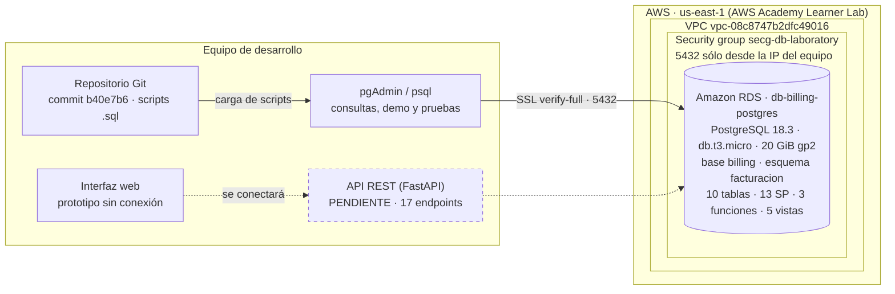
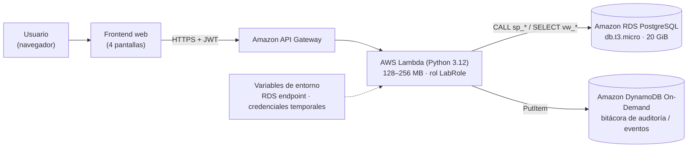
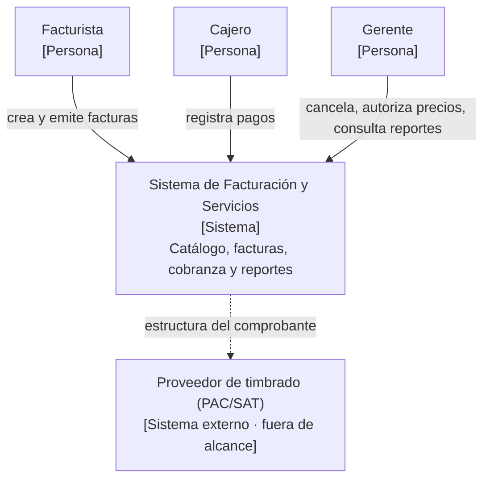
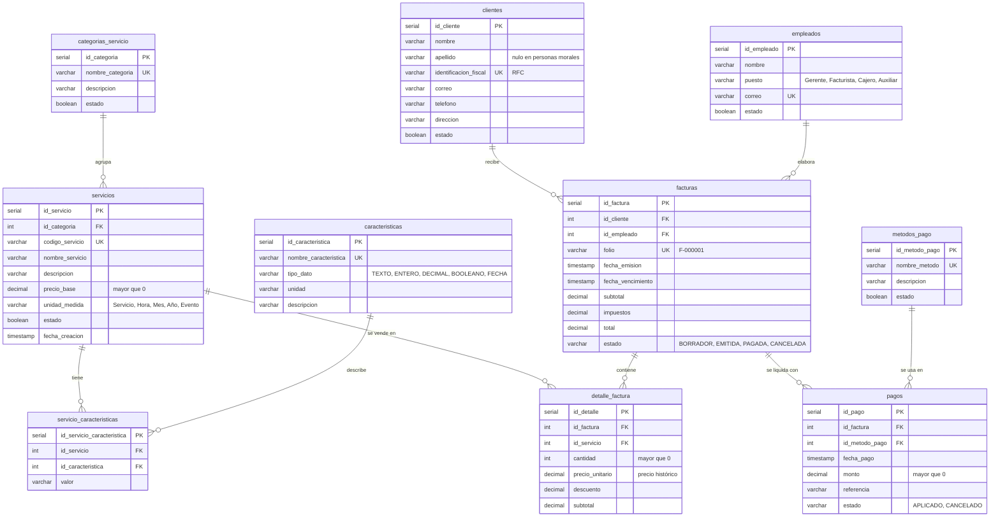
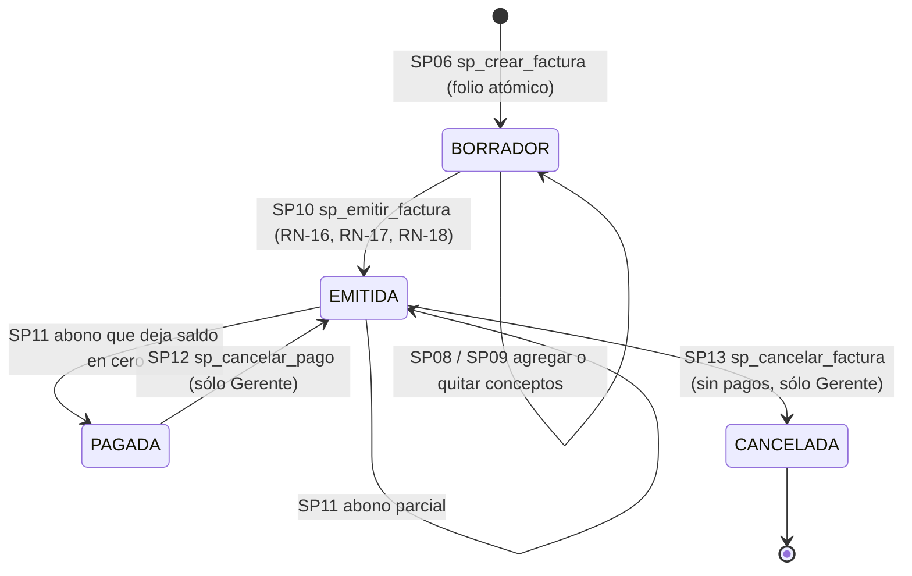
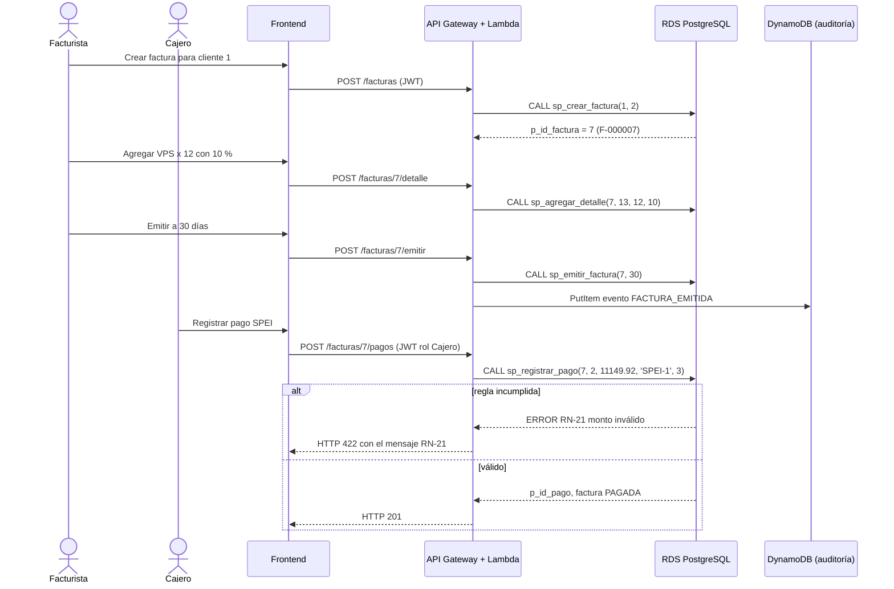
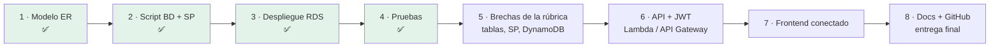

# Sistema de Facturación y Servicios: Reporte de Avance (Revisión 1)

> **Versión preliminar, 19 de noviembre de 2026. No es la versión final.**
> Optativa I · Bases de Datos en la Nube · Proyecto C · Entorno: AWS Academy Learner Lab
> **Equipo 3:** Dana Bahena Díaz, Isaac Leonardo López Flores, Renata Lizbeth Ortiz Chávez, Daniel Rosales Alanis

Sugerencia de ubicación en el repositorio: `docs/REPORTE_AVANCE.md`. Los diagramas usan **Mermaid**, que GitHub dibuja automáticamente al abrir el archivo.

## Contenido
1. [Resumen del avance](#1-resumen-del-avance)
2. [Evaluación contra la rúbrica oficial](#2-evaluación-contra-la-rúbrica-oficial)
3. [Arquitectura y servicios utilizados](#3-arquitectura-y-servicios-utilizados)
4. [Modelo de datos](#4-modelo-de-datos)
5. [Lógica de negocio](#5-lógica-de-negocio)
6. [Pruebas y evidencias](#6-pruebas-y-evidencias)
7. [Progreso de desarrollo](#7-progreso-de-desarrollo)
8. [Pendientes para la versión final](#8-pendientes-para-la-versión-final)
9. [Parte visual: prototipo y guion de pruebas](#9-parte-visual-prototipo-y-guion-de-pruebas)
10. [Cómo generar reportes](#10-cómo-generar-reportes)
11. [Cómo generar y exportar los diagramas](#11-cómo-generar-y-exportar-los-diagramas)
12. [Documentos relacionados](#12-documentos-relacionados)

---

## 1. Resumen del avance

La base de datos relacional está desplegada en Amazon RDS y probada (31 de 31 pruebas). Ya cumple el volumen que pide la rúbrica (100 servicios y 50 características) y el mínimo de 10 procedimientos (tiene 13). Frente a la rúbrica del Proyecto C faltan 2 tablas requeridas, DynamoDB, 3 de los 10 propósitos de procedimientos y la capa de aplicación con autenticación. Si se entregara hoy, la estimación interna es de **42 a 67 puntos de 100** (sección 2.3).

| Área | Estado | Evidencia principal |
| --- | --- | --- |
| Modelo de datos | Completado | Diagrama ER de 10 tablas con justificación por tabla (sección 4) |
| Base de datos y reglas de negocio | Completado | `facturacion_completo.sql`: 10 tablas, 13 SP, 3 funciones, 5 vistas |
| Despliegue en la nube | Completado | Instancia `db-billing-postgres` en Amazon RDS, PostgreSQL 18.3 |
| Pruebas | Completado | `resultado_pruebas.txt`: 31 OK, 0 fallas |
| Control de versiones | En progreso | Repositorio Git local, commit `b40e7b6`; falta subirlo a GitHub |
| Interfaz | Prototipo | Demo navegable con las mismas reglas, sin conexión a la base |
| API y aplicación conectada | Pendiente | Diseñada (17 endpoints), sin construir |
| DynamoDB, JWT, API Gateway/Lambda | Pendiente | Requeridos por la rúbrica |

---

## 2. Evaluación contra la rúbrica oficial

Fuente: *Lineamientos Técnicos y Rúbrica de Evaluación de Proyectos Finales*, Proyecto C: Sistema de Facturación y Servicios.

### 2.1 Requisitos específicos del Proyecto C

| Requisito de la rúbrica | Estado | Evidencia o brecha |
| --- | --- | --- |
| 100 servicios | ✅ Cumplido | 100 servicios en 10 categorías, cargados con SP02 |
| 50 características configurables | ✅ Cumplido | 50 características tipificadas y 1,220 valores en `servicio_caracteristicas` |
| Mínimo 8 tablas en RDS | ✅ En número (10) | Faltan 2 de las tablas que la rúbrica nombra |
| Clientes, Facturas, Detalle_Factura, Servicios, Características_Servicio, Pagos | ✅ Cumplido | `clientes`, `facturas`, `detalle_factura`, `servicios`, `caracteristicas` + `servicio_caracteristicas`, `pagos` |
| Impuestos_Histórico | ❌ Falta | El IVA está fijo en `fn_tasa_iva()` (16 %); no hay historial de tasas ni retenciones |
| Usuarios_Roles | ⚠️ Parcial | `empleados.puesto` funciona como rol; no hay usuarios con credenciales ni tabla de roles |
| DynamoDB (auditoría, sesiones, carritos o eventos) | ❌ Falta | Ninguna tabla de DynamoDB todavía |
| Mínimo 10 SP en RDS | ✅ En número (13) | La rúbrica pide 10 propósitos específicos (ver 2.2) |

### 2.2 Los 10 procedimientos que pide la rúbrica

| # | Propósito requerido | Implementado hoy | Estado |
| --- | --- | --- | --- |
| 1 | Generación e iteración atómica de folios | SP06 `sp_crear_factura` con `pg_advisory_xact_lock` | ✅ Cumplido |
| 2 | Cálculo de subtotal, IVA y retenciones | SP07 `sp_recalcular_totales` (subtotal e IVA) | ⚠️ Faltan retenciones |
| 3 | Descuentos por cliente o volumen | SP08 aplica un % capturado por renglón (0 a 50 %) | ⚠️ Falta la regla automática |
| 4 | Cancelación formal y reversión contable | SP13 cancela facturas; SP12 revierte pagos | ⚠️ Falta el asiento de reversión |
| 5 | Cierre y consolidado fiscal diario o mensual | — | ❌ Falta |
| 6 | Validación de estados de pago | SP11 y SP12 | ✅ Cumplido |
| 7 | Reporte de antigüedad de saldos | `vw_facturas` calcula días de atraso | ⚠️ Faltan los rangos de antigüedad |
| 8 | Estructura para comprobante o timbrado | — | ❌ Falta |
| 9 | Asignación masiva de características | SP03 asigna una a la vez | ⚠️ Falta la versión masiva |
| 10 | Auditoría de cambios en tarifas | SP04 valida el cambio, pero no lo registra | ❌ Falta |

**Resultado:** 2 cumplidos, 5 parciales y 3 faltantes.

### 2.3 Autoevaluación por rubro (estimación interna, no oficial)

| Rubro | Peso | Nivel actual | Puntos estimados | Qué lo sube a Excelente |
| --- | --- | --- | --- | --- |
| 1. Diseño, modelado y rigor en BD | 30 | Suficiente | 18–25 | Impuestos_Histórico, Usuarios_Roles, esquema de DynamoDB con índices |
| 2. Arquitectura en AWS y Learner Lab | 25 | Insuficiente a suficiente | 8–14 | API Gateway + Lambda con LabRole, DynamoDB, variables de entorno, apagar RDS fuera de horario |
| 3. Lógica de negocio y SP | 20 | Suficiente | 11–16 | Completar los 10 propósitos y llamarlos desde la aplicación |
| 4. Ciberseguridad, RBAC y OWASP | 15 | Insuficiente | 3–7 | JWT, bcrypt o Argon2, roles en la API, pruebas contra inyección SQL y XSS |
| 5. Frontend, documentación y Git | 10 | Insuficiente | 2–5 | Frontend conectado, GitHub con commits de los 4 integrantes, OpenAPI, README |
| **Total** | **100** | | **42–67** | |

### 2.4 Checklist de entregables del repositorio

| Entregable | Estado |
| --- | --- |
| `/database`: DDL y DML | ✅ Listo en `db/facturacion_completo.sql`; mover a `/database` |
| `/database`: script independiente de Stored Procedures | ⚠️ Por separar |
| `/database`: esquema JSON de DynamoDB e índices | ❌ Falta |
| `/docs`: diagrama ER actualizado | ✅ Sección 4 de este archivo |
| `/docs`: diagrama de arquitectura AWS | ✅ Actual y objetivo en la sección 3 |
| `/docs`: colección de Postman u OpenAPI | ❌ Falta |
| Código Python (FastAPI o Lambda) y frontend | ❌ Falta (sólo prototipo) |
| `README.md` con instrucciones de ejecución y conexión a AWS | ❌ Falta |
| Repositorio en GitHub | ❌ Falta (local, 1 commit) |

---

## 3. Arquitectura y servicios utilizados

### 3.1 Arquitectura actual (Revisión 1)



### 3.2 Arquitectura objetivo (versión final, la que pide la rúbrica)



### 3.3 Vista C4: contexto del sistema (nivel 1)



### 3.4 Servicios y herramientas

| Servicio o herramienta | Uso en el proyecto | Por qué se eligió |
| --- | --- | --- |
| Amazon RDS for PostgreSQL 18.3 | Base de datos (`db-billing-postgres`, db.t3.micro, 20 GiB gp2, us-east-1) | Base administrada con respaldos, cifrado y parches; cumple el límite del Learner Lab |
| Amazon VPC y Security Groups | Red y firewall de la instancia | El puerto 5432 sólo acepta la IP del equipo |
| AWS Academy Learner Lab | Cuenta y consola de AWS | Entorno oficial de la materia (crédito de 100 USD) |
| PostgreSQL (PL/pgSQL) | Tablas, 13 SP, 3 funciones, 5 vistas | Procedimientos con transacciones y control de errores por regla |
| PostgreSQL 16 local | Validación previa y plan B para la demo | Mismo comportamiento sin depender de la red |
| pgAdmin 4 y psql | Carga de scripts, consultas y demo | Clientes oficiales de PostgreSQL |
| Git | Control de versiones | Historial y trabajo coordinado |
| draw.io | Modelo entidad-relación original | Diagrama editable por el equipo |
| Claude (asistente de IA) | Apoyo en especificaciones, scripts, pruebas, prototipo y documentación | El equipo revisó y validó cada entregable |
| *Planeado:* API Gateway, Lambda, DynamoDB, FastAPI, psycopg 3 | Capa de aplicación | Requeridos por la rúbrica |

---

## 4. Modelo de datos

10 tablas en tercera forma normal y 9 llaves foráneas. Se implementó sin cambiar nombres ni campos del diagrama original del Equipo 3.

### 4.1 Diagrama entidad-relación



### 4.2 Justificación por tabla

| Tabla | Por qué es una entidad propia |
| --- | --- |
| categorias_servicio | El rubro se repetiría en decenas de servicios; separado, un cambio de nombre se hace en un solo lugar y permite reportes por rubro |
| servicios | Catálogo central: un servicio existe aunque nunca se haya facturado y se captura una sola vez |
| caracteristicas | Diccionario de 50 especificaciones con tipo de dato y unidad, para que «Garantía» signifique y se mida igual en todo el sistema |
| servicio_caracteristicas | Resuelve la relación N:M y guarda el valor, que es atributo de la relación |
| clientes | Un cliente tiene muchas facturas; sus datos fiscales se capturan una vez |
| empleados | Trazabilidad de quién elaboró cada factura y permisos por puesto |
| metodos_pago | Catálogo fijo que evita variantes escritas a mano que romperían los reportes |
| facturas | Encabezado del comprobante: fechas, totales y estado; de él dependen renglones y pagos |
| detalle_factura | Varios conceptos por factura sin violar 1FN; conserva el precio histórico |
| pagos | Una factura puede liquidarse en varios abonos; la suma contra el total da el saldo |

### 4.3 Normalización

- **1FN:** un valor por celda. Conceptos en `detalle_factura` y valores de características en `servicio_caracteristicas`.
- **2FN:** llaves primarias simples, así que no hay dependencias parciales.
- **3FN:** sin dependencias transitivas. Categoría, cliente, empleado y método de pago se referencian por FK.
- **Desnormalización deliberada:** `detalle_factura.precio_unitario` copia el precio al momento de la venta. Los totales se recalculan siempre desde el detalle con un SP, y el saldo no se guarda: se calcula.

### 4.4 Índices

`ix_servicios_categoria`, `ix_sc_caracteristica`, `ix_facturas_cliente`, `ix_facturas_estado`, `ix_detalle_factura`, `ix_pagos_factura`, además de los índices únicos de `codigo_servicio`, `identificacion_fiscal`, `folio`, `nombre_metodo`, `correo` y del par `(id_servicio, id_caracteristica)`.

---

## 5. Lógica de negocio

24 reglas (RN-01 a RN-24) viven en 13 procedimientos almacenados. Si una regla falla, el SP lanza un error con su código y la base revierte la operación completa.

### 5.1 Ciclo de vida de la factura



### 5.2 Secuencia de emisión y cobro (versión final, a través de la API)



### 5.3 Procedimientos por módulo

| Módulo | Procedimientos | Reglas |
| --- | --- | --- |
| Clientes | SP01 `sp_registrar_cliente` | RN-01 RFC válido · RN-02 RFC único · RN-03 correo y apellido |
| Catálogo | SP02 `sp_registrar_servicio`, SP03 `sp_asignar_caracteristica`, SP04 `sp_actualizar_precio`, SP05 `sp_cambiar_estado_servicio` | RN-04 a RN-09 |
| Facturación | SP06 `sp_crear_factura`, SP07 `sp_recalcular_totales`, SP08 `sp_agregar_detalle`, SP09 `sp_eliminar_detalle`, SP10 `sp_emitir_factura` | RN-10 a RN-18 |
| Cobranza | SP11 `sp_registrar_pago`, SP12 `sp_cancelar_pago`, SP13 `sp_cancelar_factura` | RN-19 a RN-24 |

Funciones: `fn_saldo_factura`, `fn_empleado_puede`, `fn_tasa_iva`.
Vistas: `vw_catalogo_servicios`, `vw_ficha_servicio`, `vw_facturas`, `vw_ventas_categoria`, `vw_cobranza_metodo`.

### 5.4 Permisos por puesto

| Puesto | Puede |
| --- | --- |
| Gerente | Todo, incluidas cancelaciones y cambios de precio mayores a ±30 % |
| Facturista | Crear, editar y emitir facturas |
| Cajero | Registrar pagos |
| Auxiliar | Sólo consultar |

### 5.5 Fórmulas

- Renglón: `descuento = cantidad × precio × % / 100`; `subtotal = cantidad × precio − descuento`
- Factura: `impuestos = subtotal × 0.16`; `total = subtotal + impuestos`
- `saldo = total − Σ pagos APLICADOS`

---

## 6. Pruebas y evidencias

Carga en Amazon RDS (PostgreSQL 18.3, SSL `verify-full`) el 19 de noviembre de 2026: sin errores y sin modificar el script. Antes se validó en PostgreSQL 16.15 local.

### 6.1 Verificación de mínimos en RDS

| Requisito | Obtenido | Mínimo |
| --- | --- | --- |
| Tablas | 10 | 8 |
| Procedimientos almacenados | 13 | 10 |
| Servicios | 100 | 100 |
| Características | 50 | 50 |
| Valores servicio-característica | 1,220 | — |

### 6.2 Pruebas de reglas de negocio (`facturacion_pruebas.sql`)

| Módulo | Pruebas | Reglas verificadas | Resultado |
| --- | --- | --- | --- |
| Clientes | 4 | RN-01 a RN-03 | 4 OK |
| Catálogo | 10 | RN-04 a RN-09 | 10 OK |
| Facturación | 9 | RN-10, RN-12 a RN-14, RN-16 a RN-18 | 9 OK |
| Cobranza | 8 | RN-19 a RN-21, RN-23, RN-24 | 8 OK |
| **Total** | **31** | | **31 OK, 0 fallas** |

Las reglas que se cumplen al aceptar una operación (RN-11, RN-15 y RN-22) se comprueban con los datos semilla, que se cargan con los mismos SP.

### 6.3 Escenarios cargados (`vw_facturas`)

| Folio | Cliente | Total (MXN) | Saldo (MXN) | Estado | Qué demuestra |
| --- | --- | --- | --- | --- | --- |
| F-000001 | Comercializadora del Valle de México | 42,466.67 | 0.00 | PAGADA | Pago en una exhibición |
| F-000002 | Tecnologías Integrales del Norte | 162,110.00 | 82,110.00 | EMITIDA | Dos abonos con distinto método |
| F-000003 | Jorge Gómez Martínez | 1,508.00 | 0.00 | CANCELADA | Cancelación por Gerente |
| F-000004 | Educación Superior Digital | 20,555.20 | 20,555.20 | EMITIDA | Crédito a 30 días con descuento |
| F-000005 | Sofía Ramírez Sánchez | 2,784.00 | 2,784.00 | EMITIDA | Pago cancelado: regresó a EMITIDA |
| F-000006 | Hospital San Rafael | 25,520.00 | — | BORRADOR | Edición con un concepto eliminado |

Evidencia: `db/resultado_pruebas.txt` y commit `b40e7b6`. Las fechas se guardan en UTC, 6 horas adelante de la hora del centro de México.

---

## 7. Progreso de desarrollo

### 7.1 Bitácora de hitos

| Fecha | Hito | Resultado |
| --- | --- | --- |
| 19 nov 2026 | Evaluación contra la rúbrica oficial | Brechas identificadas y plan priorizado por puntos |
| 19 nov 2026 | Prototipo de interfaz | Demo navegable de 4 pantallas con las mismas reglas |
| 19 nov 2026 | Carga y pruebas en RDS | PostgreSQL 18.3, 31 de 31 pruebas en OK |
| 19 nov 2026 | Control de versiones | Commit `b40e7b6`, sin credenciales ni certificados |
| 19 nov 2026 | Acceso de red | Regla del security group actualizada a la IP vigente |
| 17 nov 2026 | Revisión de infraestructura | Se confirmó la instancia RDS existente |
| 17 nov 2026 | Adaptación al modelo del Equipo 3 | Script sobre las 10 tablas del diagrama |
| 17 nov 2026 | Especificaciones técnicas | Requerimientos, catálogo, SP y reparto por equipo |
| Antes del 17 nov | Modelo entidad-relación | draw.io con justificación por tabla |
| 11 oct 2026 | Infraestructura base | Creación de `db-billing-postgres` |

### 7.2 Avance por fases



---

## 8. Pendientes para la versión final

### Prioridad 1 · Base de datos (rubros 1 y 3, 50 puntos)
- [ ] Tablas `impuestos_historico` (IVA y retenciones con vigencia), `usuarios` y `roles` (contraseña en hash)
- [ ] Tabla de auditoría de tarifas; SP04 registra cada cambio
- [ ] SP faltantes: retenciones, descuento automático por cliente o volumen, reversión contable, cierre fiscal diario y mensual, antigüedad de saldos por rangos, estructura del comprobante (JSON), asignación masiva de características
- [ ] Script independiente de SP en `/database`

### Prioridad 2 · Arquitectura en AWS (rubro 2, 25 puntos)
- [ ] DynamoDB On-Demand para la bitácora o los eventos inmutables, con esquema JSON e índices
- [ ] API en Lambda (Python, 128–256 MB, `LabRole`) detrás de API Gateway
- [ ] Endpoints y credenciales temporales en variables de entorno; script de despliegue
- [ ] Apagar RDS fuera de horario y activar la protección contra borrado

### Prioridad 3 · Seguridad (rubro 4, 15 puntos)
- [ ] JWT y contraseñas con bcrypt o Argon2
- [ ] Permisos por rol en cada endpoint
- [ ] Consultas parametrizadas, escape contra XSS y pruebas que lo demuestren

### Prioridad 4 · Frontend, documentación y Git (rubro 5, 10 puntos)
- [ ] Frontend conectado a la API
- [ ] GitHub con commits de los 4 integrantes
- [ ] OpenAPI o colección de Postman en `/docs`
- [ ] `README.md` de despliegue y pruebas

### Riesgos

| Riesgo | Impacto | Mitigación |
| --- | --- | --- |
| Las sesiones del Learner Lab expiran | La aplicación pierde conexión | Credenciales y endpoints en variables de entorno |
| La IP del equipo cambia | No hay conexión desde un cliente local | Revisarla antes de cada sesión; Lambda no depende de ella |
| Agotar los 100 USD | Se detiene el laboratorio | Apagar RDS, DynamoDB On-Demand, Lambda 128–256 MB |
| La instancia no tiene protección contra borrado | Pérdida de la base | Activarla; el script reconstruye todo en minutos |

### Preguntas para el profesor
1. ¿Cuál es la fecha de la entrega final y de la demostración en vivo?
2. ¿Qué retenciones debe calcular el sistema (por ejemplo, ISR 10 % y dos terceras partes del IVA cuando el cliente es persona moral)?
3. ¿El cierre fiscal basta como consolidado diario y mensual en una tabla, o hay un formato específico?

---

## 9. Parte visual: prototipo y guion de pruebas

### 9.1 Prototipo de interfaz

- **Enlace:** https://claude.ai/artifact/9KhSHdPbUj8YcJgtcBZ5Rh (compartirlo antes de la revisión)
- **Qué es:** aplicación web de 4 pantallas que usa los mismos datos semilla y aplica las mismas reglas que los SP. **No está conectada a RDS:** los datos viven en el navegador y se reinician al recargar.
- **Consola SQL lateral:** cada acción muestra el `CALL` equivalente y su resultado o error RN-xx.

| Pantalla | Qué muestra | Equivalente en la base |
| --- | --- | --- |
| Panel | Requisitos cumplidos, por cobrar, cobrado, ventas por categoría | `vw_ventas_categoria`, conteos |
| Catálogo | 100 servicios con filtro y ficha técnica | `vw_catalogo_servicios`, `vw_ficha_servicio` |
| Nueva factura | Cliente → conceptos → IVA y total → emitir | SP06, SP08, SP09, SP10 |
| Facturas y cobranza | Lista con saldo; abonos, cancelar pago, cancelar factura | `vw_facturas`, SP11, SP12, SP13 |

### 9.2 Guion visual de pruebas (en el prototipo)

| # | Acción | «Actuando como» | Resultado esperado |
| --- | --- | --- | --- |
| 1 | Catálogo → SRV-013 | cualquiera | Ficha con 13 características (RAM 4 GB, 2 vCPU, 99.9 %) |
| 2 | Nueva factura → cliente 1 → Crear borrador | Ana Torres (Facturista) | `CALL sp_crear_factura(1, 2)` → F-000007 |
| 3 | Agregar VPS 2 vCPU × 12, 10 % → Emitir a 30 días | Ana Torres | Total $11,149.92 |
| 4 | Registrar abono de $5,000 por SPEI | Carlos Ruiz (Cajero) | Saldo $6,149.92 |
| 5 | Cancelar factura | Carlos Ruiz | ❌ RN-24: tiene pagos aplicados (y sólo un Gerente puede cancelar) |
| 6 | Registrar abono por $6,149.92 | Carlos Ruiz | Factura PAGADA |
| 7 | Nueva factura → Crear borrador | Diego Salas (Auxiliar) | ❌ RN-10: no puede facturar |
| 8 | Abono con «Cheque nominativo» en F-000002 | Carlos Ruiz | ❌ RN-20: método inactivo |
| 9 | En un borrador nuevo, agregar concepto con 60 % de descuento | Ana Torres | ❌ RN-14: máximo 50 % |

### 9.3 El mismo guion contra RDS (pgAdmin o psql)

```sql
SET search_path TO facturacion;
SELECT * FROM vw_ficha_servicio WHERE codigo_servicio = 'SRV-013';
CALL sp_crear_factura(1, 2);                     -- anotar el id devuelto (<id>)
CALL sp_agregar_detalle(<id>, 13, 12, 10);
CALL sp_emitir_factura(<id>, 30);
CALL sp_registrar_pago(<id>, 2, 5000, 'SPEI-DEMO1', 3);
CALL sp_cancelar_factura(<id>, 3);               -- RN-24
CALL sp_registrar_pago(<id>, 2, 6149.92, 'SPEI-DEMO2', 3);
CALL sp_crear_factura(1, 4);                     -- RN-10
CALL sp_registrar_pago(2, 5, 100, 'x', 3);       -- RN-20
SELECT * FROM vw_facturas;
```

### 9.4 Capturas de evidencia sugeridas (`docs/evidencias/`)

| Archivo | Qué capturar |
| --- | --- |
| `01_rds_instancia.png` | Consola RDS: `db-billing-postgres` en estado Available, db.t3.micro, 20 GiB |
| `02_security_group.png` | Regla de entrada 5432 limitada a una IP /32 |
| `03_conteos.png` | Resultado de la consulta de mínimos (10 / 13 / 100 / 50 / 1220) |
| `04_pruebas_31_ok.png` | `resultado_pruebas.txt` con los 31 OK |
| `05_vw_facturas.png` | Las 6 facturas con sus estados |
| `06_error_regla.png` | Un `CALL` rechazado con su código RN-xx |
| `07_prototipo_panel.png` | Panel del prototipo |
| `08_prototipo_consola.png` | Consola SQL del prototipo después del guion |
| `09_erd_pgadmin.png` | ERD generado por pgAdmin desde la base real |

---

## 10. Cómo generar reportes

Todas las consultas van sobre el esquema `facturacion`. Para exportar a CSV desde psql:

```sql
\copy (SELECT * FROM facturacion.vw_facturas) TO 'docs/reportes/facturas.csv' CSV HEADER
```

### 10.1 Cumplimiento de mínimos

```sql
SET search_path TO facturacion;
SELECT 'Tablas' AS requisito, count(*) FROM information_schema.tables
 WHERE table_schema = 'facturacion' AND table_type = 'BASE TABLE'
UNION ALL SELECT 'Procedimientos', count(*) FROM information_schema.routines
 WHERE routine_schema = 'facturacion' AND routine_type = 'PROCEDURE'
UNION ALL SELECT 'Servicios', count(*) FROM servicios
UNION ALL SELECT 'Características', count(*) FROM caracteristicas
UNION ALL SELECT 'Valores servicio-característica', count(*) FROM servicio_caracteristicas;
```

### 10.2 Antigüedad de saldos por rangos

Hoy es una consulta; en la versión final pasará a un SP.

```sql
SELECT cliente, rfc,
       sum(saldo) FILTER (WHERE fecha_vencimiento >= now())                      AS al_corriente,
       sum(saldo) FILTER (WHERE dias_atraso BETWEEN 1  AND 30)                   AS "1_30",
       sum(saldo) FILTER (WHERE dias_atraso BETWEEN 31 AND 60)                   AS "31_60",
       sum(saldo) FILTER (WHERE dias_atraso BETWEEN 61 AND 90)                   AS "61_90",
       sum(saldo) FILTER (WHERE dias_atraso > 90)                                AS mas_de_90,
       sum(saldo)                                                                AS total
  FROM facturacion.vw_facturas
 WHERE estado = 'EMITIDA' AND saldo > 0
 GROUP BY cliente, rfc
 ORDER BY total DESC;
```

### 10.3 Ventas por mes (base para el cierre fiscal)

```sql
SELECT date_trunc('month', fecha_emision AT TIME ZONE 'UTC' AT TIME ZONE 'America/Mexico_City')::date AS mes,
       count(*)        AS facturas,
       sum(subtotal)   AS subtotal,
       sum(impuestos)  AS iva,
       sum(total)      AS total
  FROM facturacion.facturas
 WHERE estado IN ('EMITIDA', 'PAGADA')
 GROUP BY 1 ORDER BY 1;
```

### 10.4 Otros reportes listos

| Reporte | Consulta |
| --- | --- |
| Ventas netas por categoría | `SELECT * FROM facturacion.vw_ventas_categoria;` |
| Cobranza por método de pago | `SELECT * FROM facturacion.vw_cobranza_metodo;` |
| Catálogo con número de características | `SELECT * FROM facturacion.vw_catalogo_servicios;` |
| Ficha técnica de un servicio | `SELECT * FROM facturacion.vw_ficha_servicio WHERE codigo_servicio = 'SRV-001';` |
| Servicios más vendidos | ver abajo |

```sql
SELECT s.codigo_servicio, s.nombre_servicio, sum(d.cantidad) AS unidades, sum(d.subtotal) AS venta_neta
  FROM facturacion.detalle_factura d
  JOIN facturacion.servicios s USING (id_servicio)
  JOIN facturacion.facturas  f USING (id_factura)
 WHERE f.estado IN ('EMITIDA', 'PAGADA')
 GROUP BY s.codigo_servicio, s.nombre_servicio
 ORDER BY venta_neta DESC LIMIT 10;
```

### 10.5 Gráficas a partir de los reportes (opcional, Python)

```python
# pip install psycopg[binary] pandas matplotlib python-dotenv
import os, psycopg, pandas as pd, matplotlib.pyplot as plt
from dotenv import load_dotenv
load_dotenv()  # lee PGHOST, PGUSER, PGPASSWORD, etc. del .env (nunca en el código)
with psycopg.connect(sslmode="verify-full", sslrootcert=os.environ["PGSSLROOTCERT"]) as cx:
    df = pd.read_sql("SELECT * FROM facturacion.vw_ventas_categoria", cx)
ax = df.plot.barh(x="nombre_categoria", y="venta_neta", legend=False)
ax.set_xlabel("Venta neta (MXN)"); ax.set_ylabel("")
plt.tight_layout(); plt.savefig("docs/reportes/ventas_categoria.png", dpi=150)
```

---

## 11. Cómo generar y exportar los diagramas

| Necesitas | Cómo |
| --- | --- |
| Verlos en GitHub | Sube este `.md`: GitHub dibuja los bloques ` ```mermaid ` automáticamente |
| PNG o SVG | Copia cada bloque a un archivo `.mmd` y ejecuta `npx -y @mermaid-js/mermaid-cli -i docs/er.mmd -o docs/er.png` (requiere Node.js) |
| Editarlos visualmente | https://mermaid.live : pega el bloque y descarga PNG o SVG |
| Pasarlos a draw.io | draw.io → *Arrange → Insert → Advanced → Mermaid*, pega el bloque |
| ER desde la base real | pgAdmin: clic derecho sobre la base `billing` → *ERD For Database*, o DBeaver: esquema `facturacion` → pestaña *ER Diagram* |
| Diagrama de AWS con íconos oficiales | draw.io → biblioteca *AWS 2025 / AWS19*, siguiendo la estructura de la sección 3.2 |

Diagramas de este archivo: arquitectura actual (3.1), arquitectura objetivo (3.2), contexto C4 (3.3), entidad-relación (4.1), ciclo de vida de la factura (5.1), secuencia de emisión y cobro (5.2) y avance por fases (7.2).

---

## 12. Documentos relacionados

- Especificaciones técnicas: https://claude.ai/artifact/Cr6P2ecmVk3tDjh8MbDSpb
- Reporte de avance (versión editable): https://claude.ai/artifact/Vnb1UvgPUG5hqHFq6ovPHT
- Prototipo de interfaz: https://claude.ai/artifact/9KhSHdPbUj8YcJgtcBZ5Rh
- Scripts: `db/facturacion_completo.sql`, `db/facturacion_pruebas.sql`, `db/resultado_pruebas.txt`
- Contexto para Claude Code: `CONTEXTO_CLAUDE_CODE.md`
- Modelo ER original: `BdOptativa.drawio`
- Rúbrica: *Lineamientos Técnicos y Rúbrica de Evaluación de Proyectos Finales* (Optativa I)

> Los enlaces de claude.ai son privados hasta que se comparten desde el botón «Compartir» de cada uno.
